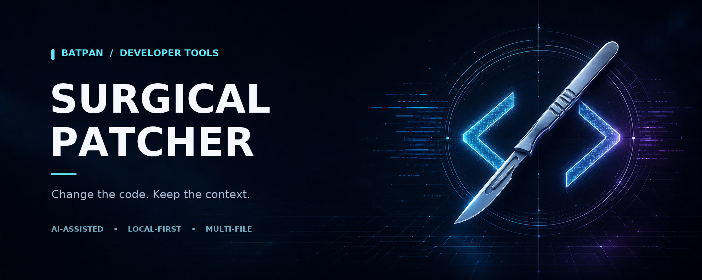
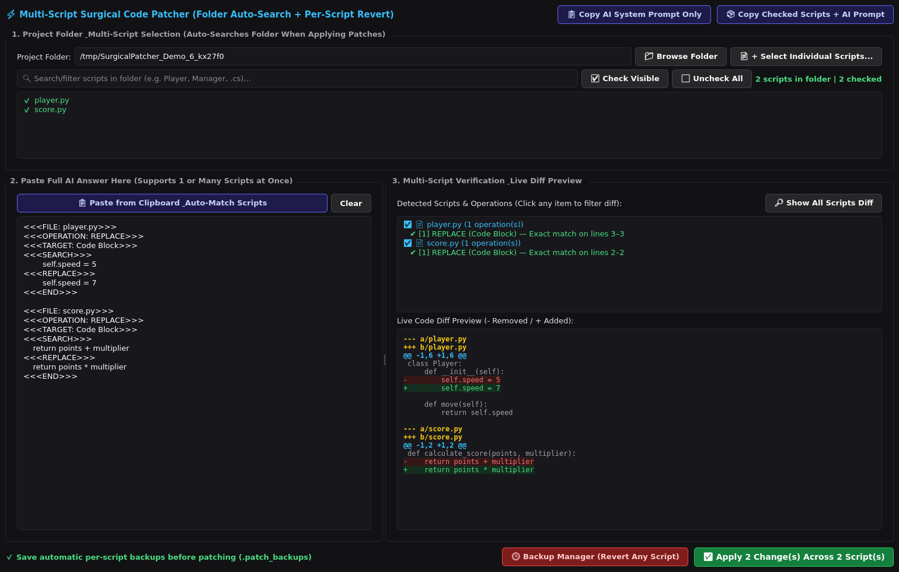

<p align="center">
  
</p>

<h1 align="center">🦇 BATPAN Surgical Patcher</h1>

<p align="center"><strong>Let your AI return the fix — not the entire script.</strong></p>

<p align="center">
  <a href="bp_surgicalpatcher_v2.py"></a>
  <a href="https://www.python.org/"></a>
  <a href="https://pypi.org/project/PyQt6/"></a>
  
</p>

<p align="center">
  <a href="#-why-surgical-patcher">Why use it?</a> ·
  <a href="#-installation">Installation</a> ·
  <a href="#-quick-start">Quick start</a> ·
  <a href="#-the-patch-format">Patch format</a> ·
  <a href="#-backups--recovery">Backups</a> ·
  <a href="#-important-safety-notes">Safety</a>
</p>

---

When you ask an AI to fix a large script, having it print the entire file again can consume a lot of output tokens — even when only a few lines need to change. **BATPAN Surgical Patcher** offers another workflow: ask for just the relevant search and replacement blocks, then preview and apply those changes to one or more local files.

It is a **PyQt6 desktop application**, not an AI model. You choose the files, copy the provided instructions and context to your AI, and paste the AI's answer back into the app. The patcher matches the edits, displays a colored diff, and can save backups before writing.

> **The token-saving idea:** Short patches can reduce *output* tokens compared with regenerating complete files. Sending full selected scripts and the instructions still uses *input* tokens; the actual savings depend on your task, model, and conversation.

<p align="center">
  
  <br><em>The desktop app previewing two edits in a sample project.</em>
</p>

## 🚀 Why Surgical Patcher?

| Your workflow | What Surgical Patcher adds |
| :--- | :--- |
| **Ask for a focused fix** | Supplies a ready-to-copy prompt requesting small, structured changes instead of whole scripts. |
| **Work across several files** | Reads multiple file headers and operations from one AI response and groups the changes by file. |
| **Review before writing** | Simulates the detected edits, reports matches and problems, and shows a color-coded unified diff. |
| **Keep a way back** | Optionally saves a backup of each file before patching and provides a per-file history and restore dialog. |
| **Stay in control of your code** | Runs locally with a manual clipboard workflow; the app itself does not connect to an AI service or require an API key. |

---

## ✨ What the application does

- **Finds project files:** Browse to a folder to scan it recursively, filter the list, check visible files, or add individual files through the file picker.
- **Prepares AI context:** Copy either the patch-format prompt alone or the prompt together with the full contents of your checked files.
- **Accepts a whole AI answer:** Paste from the clipboard or type into the patch box. The app extracts file and operation blocks from the surrounding response, then analyzes them as the text changes.
- **Resolves target files:** Prefers checked files, then searches the other files in the scanned/selected pool. It can use a relative path, filename, a single checked file, or a unique content match. **Checked files are not a strict patching whitelist.**
- **Supports four edit operations:** `REPLACE`, `INSERT_BEFORE`, `INSERT_AFTER`, and `DELETE`. Multiple operations on the same file are simulated in order, so later searches see earlier simulated changes.
- **Checks anchors and previews changes:** Reports successful, missing, ambiguous, or unsupported operations. Click a file or operation to see that file's diff, or show all diffs together.
- **Checks for stale previews:** Before writing, it re-reads all planned files and stops if one has changed since the preview. Review the refreshed result before trying again.
- **Backs up and restores individual files:** Automatic backups are enabled by default. The Backup Manager can filter history by filename, compare a backup with the live file, restore one file, or delete a backup.
- **Remembers your session:** Saves the project path, checked files, and backup preference in `patcher_settings.json` next to the script.

The app reads target files as **UTF-8**, rejects files it cannot decode, and preserves uniform LF or CRLF line endings when applying a patch. See the [safety notes](#-important-safety-notes) for the limits of these checks.

---

## 📋 Requirements

- **Python 3.10 or newer.**
- **PyQt6** — the only third-party Python dependency, listed in [`requirements.txt`](requirements.txt).
- A desktop session supported by Qt. Windows, macOS, and Linux are possible; Linux may need additional Qt/X11 system libraries. The automated checks run headlessly on Linux; native desktop behavior has not been verified on every platform.
- An AI assistant you use separately, such as ChatGPT, Claude, Gemini, or a local model. Surgical Patcher does **not** include one or send prompts automatically.
- Git to clone the repository, or use GitHub's **Code → Download ZIP** option instead.

> **Dependency licensing:** The PyPI distribution of PyQt6 has its own GPL license. Review its terms separately before distributing your project.

## 📥 Installation

### Windows

1. Install Python from [python.org](https://www.python.org/downloads/) and enable **Add Python to PATH**, or install it with `winget`:

   ```powershell
   winget install --id Python.Python.3.12 --exact
   ```

2. Install [Git](https://git-scm.com/downloads) if you want to clone, then open PowerShell and run:

   ```powershell
   git clone https://github.com/BATPANn/BP_SurgicalPatcher.git
   cd BP_SurgicalPatcher

   py -3 -m venv .venv
   .\.venv\Scripts\python.exe -m pip install --upgrade pip
   .\.venv\Scripts\python.exe -m pip install -r requirements.txt
   .\.venv\Scripts\python.exe bp_surgicalpatcher_v2.py
   ```

   If you downloaded a ZIP, extract it and open PowerShell inside the extracted folder before running the `py` and `.venv` commands. A private repository requires a GitHub account with access.

### macOS / Linux

With Python 3 and Git installed, open a terminal:

```bash
git clone https://github.com/BATPANn/BP_SurgicalPatcher.git
cd BP_SurgicalPatcher

python3 -m venv .venv
.venv/bin/python -m pip install --upgrade pip
.venv/bin/python -m pip install -r requirements.txt
.venv/bin/python bp_surgicalpatcher_v2.py
```

The commands use the virtual environment's Python directly, so activating it is optional. If a Linux Qt platform plugin fails to load, see [Troubleshooting](#-troubleshooting).

---

## 📖 Quick start

```text
 Select files       Give context       Ask for a fix        Review & apply
      │                   │                   │                    │
      ▼                   ▼                   ▼                    ▼
  Project folder ──► Copy prompt + ──► AI returns patch ──► Check diff +
  / file picker      checked scripts   blocks, not files    save backups
```

1. **Protect your work.** Commit your project to Git or make an independent backup. Keep automatic backups enabled in the app as well.
2. **Choose your project.** Click **📁 Browse Folder**, or use **📄 + Select Individual Scripts…**. Filter the file list and check the scripts you want to share with the AI.
3. **Copy the instructions and context.** Click **📦 Copy Checked Scripts + AI Prompt** to copy the full checked files along with the required format. If your AI already has the code, use **📋 Copy AI System Prompt Only** instead.
4. **Ask your AI for the change.** Paste the copied material into your AI chat and describe the fix. Ask it to follow the format exactly, use project-relative file paths, and include unique, accurate search anchors.
5. **Paste the response back.** Copy the AI's answer and click **📋 Paste from Clipboard & Auto-Match Scripts**. You can also paste directly into the left-hand text box.
6. **Inspect every file and operation.** Check the number of detected changes, the resolved filenames, the match messages, and the green/red diff. The Apply button is enabled only when every *detected* operation has a valid plan. A malformed block may not be detected at all — compare the list with the AI's complete answer.
7. **Apply, then test your project.** Leave **Save automatic per-script backups** checked and click **Apply**. Run your normal tests or launch your project; a successful text match does not prove that the AI's code is correct.

> **Privacy:** The app copies selected source code to your clipboard. You decide whether to paste it into an AI service; review that service's privacy terms and remove secrets or sensitive data first.

---

## 🧩 The patch format

Each operation follows a `<<<FILE: ...>>>` header. Use a **project-relative path** when possible, especially if different folders contain files with the same name. `<<<TARGET: ...>>>` is optional; the other markers shown below are required.

Suppose `calculator.py` contains:

```python
def total(a, b):
    return a - b
```

An AI can propose the following focused change instead of returning the whole file:

```text
<<<FILE: calculator.py>>>
<<<OPERATION: REPLACE>>>
<<<TARGET: Code Block>>>
<<<SEARCH>>>
    return a - b
<<<REPLACE>>>
    return a + b
<<<END>>>
```

After review and application, the function returns `a + b`. Additional operation blocks can follow the same file header, or a new `<<<FILE: path/to/file>>>` header can introduce edits to another file.

| Operation | What happens | What goes in `<<<REPLACE>>>` |
| :--- | :--- | :--- |
| `REPLACE` | Replaces the matched search lines. | The new lines. |
| `INSERT_BEFORE` | Inserts lines immediately before the matched anchor. | The lines to insert. |
| `INSERT_AFTER` | Inserts lines immediately after the matched anchor. | The lines to insert. |
| `DELETE` | Removes the matched search lines. | Leave it empty, but **keep the `<<<REPLACE>>>` marker**. |

For example, a delete block ends with an empty replacement section:

```text
<<<FILE: calculator.py>>>
<<<OPERATION: DELETE>>>
<<<TARGET: Code Block>>>
<<<SEARCH>>>
    # obsolete comment
<<<REPLACE>>>
<<<END>>>
```

### How matching works

1. The patcher looks for a **unique line-by-line match**, ignoring trailing whitespace.
2. If that fails, it tries a unique match ignoring leading and trailing indentation. It may add indentation to the replacement based on the matched line.
3. If neither matches and `TARGET` names something other than `Code Block`, it attempts a brace-based method scan intended for languages such as C#, Java, or JavaScript.
4. Multiple matching anchors are reported as **ambiguous**. Add surrounding lines to make the `SEARCH` block unique.

**Important:** A named `TARGET` is more than a label. The brace fallback can select an *entire method* even if the supplied `SEARCH` was meant to identify only a small part of it. It is not a full language parser. Use `TARGET: Code Block` when you do not want that fallback, and always inspect the exact diff and indentation, especially around tabs or brace-based methods.

---

## 📂 File discovery

The folder scanner automatically includes these extensions:

| Category | Extensions |
| :--- | :--- |
| Python | `.py`, `.pyw` |
| Unity / C# | `.cs`, `.shader` |
| Web | `.js`, `.ts` |
| C++ | `.cpp`, `.h` |
| Godot | `.gd` |
| Data | `.json` |

Other UTF-8 text files can be chosen manually using the file picker's **All Files** filter. Automatic scanning skips directories named `.git`, `__pycache__`, `Library`, `Temp`, `Obj`, `Build`, `.patch_backups`, and `node_modules`. Other directories, including virtual environments, are **not** automatically excluded, so choose your project folder carefully.

When filenames are duplicated, checked files are prioritized and the app may choose the first candidate if it cannot disambiguate. Specify a full project-relative path and confirm the resolved file in the preview. A file referenced by the AI can be patched even when it is not checked, provided it is in the file pool.

## 🕒 Backups & recovery

With automatic backups enabled, the app saves the original file before writing its patch. Backup files and their index live under the selected project folder:

```text
your-project/
└── .patch_backups/
    ├── backup_index.json
    └── script.py.<timestamp>.<sequence>.bak
```

If there is no valid project folder, the app uses `.patch_backups` next to the script instead. The index stores absolute paths to the original and backup files; moving the project or backup folder can break the history links. A manually selected file outside the project is still backed up in the selected project's backup folder.

To restore a file:

1. Open **🕒 Backup Manager** and, if needed, filter by script name.
2. Select a backup and review its diff against the current live file.
3. Click **Revert ONLY This Script to Selected Backup** and confirm.

Restoring **overwrites the current file** and does not make another backup first. Deleting a backup removes that backup file. If automatic backups were disabled, no new recovery point was created by the app. Keep independent backups or version control even when the feature is enabled.

This repository's `.gitignore` excludes local settings and backups **in this repository**. For a different project, add this line to *that project's* `.gitignore` if you do not want its backups committed:

```gitignore
.patch_backups/
```

## ⚠ Important safety notes

- **Review the actual diff, not just a green status.** Matching a text anchor is not the same as validating the logic, syntax, or security of AI-generated code. The app does not run your tests.
- **Verify the detected operation count.** Malformed blocks may be skipped by the parser; the app cannot validate a change it did not recognize.
- **Use UTF-8 text files.** Non-UTF-8 target files are rejected during analysis. Uniform LF and CRLF endings are preserved, but mixed line endings or trailing blank lines may be normalized.
- **A batch is not an atomic transaction.** The app rechecks all files before applying, but files are then backed up and written one at a time. A write error or external edit during the write can leave a partially applied batch; the app does not automatically roll it back.
- **Backups are a convenience, not a substitute for version control.** Check the backup location and keep a separate copy of important work. Backup files contain your source code, and settings/index files can contain local paths.
- **Treat AI output as untrusted.** The patcher changes files but does not sandbox or evaluate the code. Inspect changes before applying or running them.

---

## 🔧 Troubleshooting

<details>
<summary><strong>The Apply button is disabled / no operation was found</strong></summary>

Check that the AI used the exact `<<<OPERATION: ...>>>`, `<<<SEARCH>>>`, `<<<REPLACE>>>`, and `<<<END>>>` markers, each in the expected position. Include a `<<<FILE: relative/path>>>` header before the operations for each file. Make sure all detected files are readable and all operations show a valid match. Unsupported operation names are rejected.

</details>

<details>
<summary><strong>The anchor is missing or ambiguous</strong></summary>

Provide more unique surrounding lines from the current file and keep the original indentation. The file may have changed since you sent it to the AI. Regenerate the patch from up-to-date code and inspect the diff; a named `TARGET` can also invoke the whole-method brace fallback.

</details>

<details>
<summary><strong>The wrong file is matched, or the backup list is empty</strong></summary>

Use a project-relative file path instead of a bare filename, especially for duplicates, and inspect the resolved filename before applying. The Backup Manager shows the index under the **currently selected project folder**. Check that automatic backups were enabled, the project/backup paths have not moved, and the index is readable.

</details>

<details>
<summary><strong>PyQt6 will not import or a Linux Qt platform plugin will not load</strong></summary>

Run the app with the same virtual-environment Python used to install `requirements.txt`. On Linux, use a graphical desktop session and install your distribution's Qt/X11 runtime dependencies. For example, Ubuntu/Debian systems may need packages such as `libxcb-cursor0`, `libxkbcommon0`, `libgl1`, `libegl1`, and `libdbus-1-3`; exact names and additional dependencies vary by distribution.

</details>

---

## 🧪 Running the tests

After installing the requirements, run:

```bash
python -m unittest discover -s tests -v
```

Use your virtual environment's Python if it is not activated. The tests cover parsing, matching, simulation, backup history, duplicate filenames, stale previews, UTF-8 validation, and CRLF handling. GUI tests use Qt's offscreen platform and may need the same system libraries as PyQt6.

## 📁 Repository contents

```text
BP_SurgicalPatcher/
├── bp_surgicalpatcher_v2.py   # Desktop application and patch engine
├── requirements.txt           # PyQt6 dependency
├── tests/                     # Automated regression tests
├── assets/                    # Project banner and app preview
└── README.md                  # You are here
```

## 📄 License

No license has been specified for this repository yet. Please contact the repository owner before reusing or distributing the code.

---

<p align="center"><strong>Smaller answers. Reviewable changes. More room to build.</strong><br>Made with 🦇 by BATPAN.</p>
