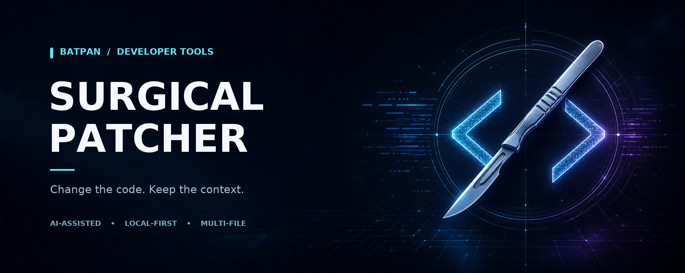
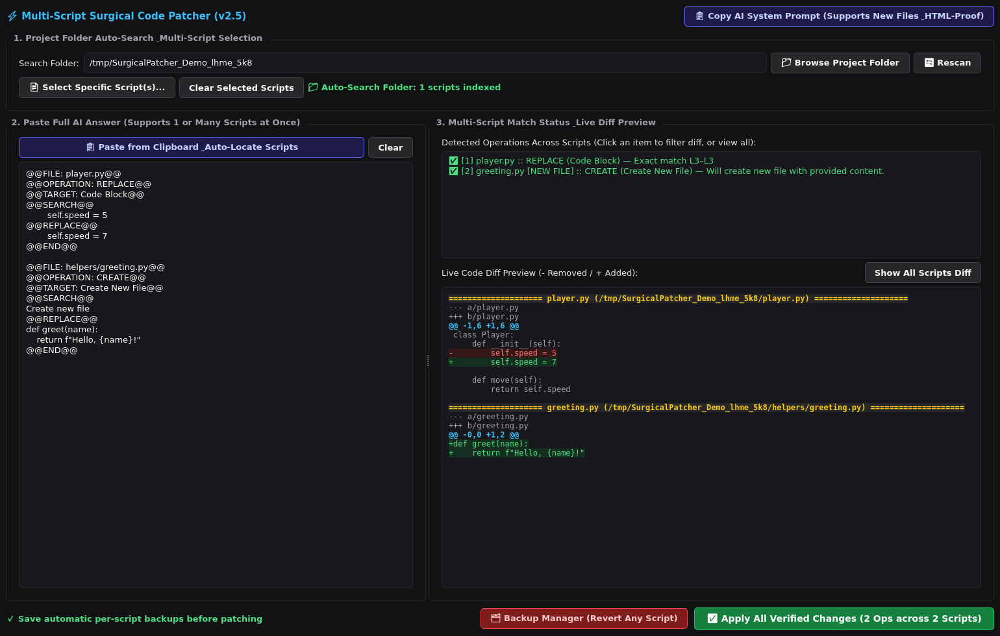

<p align="center">
  
</p>

<h1 align="center">🦇 BATPAN Surgical Patcher</h1>

<p align="center"><strong>Let your AI return the fix — not the entire script.</strong></p>

<p align="center">
  <a href="https://github.com/BATPANn/BP_SurgicalPatcher/releases/tag/v2.5"></a>
  <a href="https://www.python.org/"></a>
  <a href="https://pypi.org/project/PyQt6/"></a>
  <a href="LICENSE"></a>
  
</p>

<p align="center">
  <a href="https://github.com/BATPANn/BP_SurgicalPatcher/releases/latest">Download v2.5</a> ·
  <a href="#-why-surgical-patcher">Why use it?</a> ·
  <a href="#-installation">Installation</a> ·
  <a href="#-quick-start">Quick start</a> ·
  <a href="#-the-patch-format">Patch format</a> ·
  <a href="#-backups--recovery">Backups</a> ·
  <a href="#-important-safety-notes">Safety</a>
</p>

---

When you ask an AI to fix a large script, having it print the entire file again can consume a lot of output tokens — even when only a few lines need to change. **BATPAN Surgical Patcher** offers another workflow: ask for just the relevant search and replacement blocks, then preview and apply those changes to one or more local files. In **v2.5**, an AI can also provide the complete content for a *new* file and tell the patcher where to create it.

It is a **PyQt6 desktop application**, not an AI model. Copy its built-in instructions, provide your code context to your AI separately, and paste the AI's answer back into the app. The patcher locates existing files, previews edits and new files in a colored diff, and can save backups before writing.

> **The token-saving idea:** Small patches can reduce *output* tokens compared with regenerating complete existing files. A new file still requires its complete content, and the code and instructions you send the AI use *input* tokens. Actual savings depend on your task, model, and conversation.

<p align="center">
  
  <br><em>v2.5 previewing an existing-file edit and a new file in a sample project.</em>
</p>

## 🚀 Why Surgical Patcher?

| Your workflow | What Surgical Patcher adds |
| :--- | :--- |
| **Ask for a focused fix** | Supplies a ready-to-copy prompt requesting small, structured changes instead of whole scripts. |
| **Work across several files** | Reads multiple file headers and operations from one AI response and groups the changes by file. |
| **Create new files** | Uses a `CREATE` block and a relative path to preview and create a new script, including missing folders. |
| **Review before writing** | Simulates the detected edits, reports matches and problems, and shows a color-coded unified diff. |
| **Keep a way back** | Optionally saves a backup of each file before patching and provides a per-file history and restore dialog. |
| **Stay in control of your code** | Runs locally with a manual clipboard workflow; the app itself does not connect to an AI service or require an API key. |

---

## ✨ What the application does

- **Finds project files:** Browse to a folder to index it recursively, rescan it, or select individual files through the file picker.
- **Copies an AI prompt:** The built-in prompt asks for `@@`-tagged patches and explains how to request a new file. Supply your code context to the AI separately.
- **Accepts a whole AI answer:** Paste from the clipboard or type into the patch box. The app extracts file and operation blocks from the surrounding response and analyzes them as the text changes.
- **Resolves target files:** Searches manually selected files first, then the project index. Use relative paths to disambiguate files with the same name; files in the project can be patched even if not manually selected.
- **Supports five operations:** `REPLACE`, `INSERT_BEFORE`, `INSERT_AFTER`, `DELETE`, and **`CREATE`**. Operations on the same file are simulated in order.
- **Creates new scripts:** A `CREATE` block supplies a relative destination and the full new content. Missing parent folders are created on apply; an existing file is never overwritten by `CREATE`.
- **Checks anchors and previews changes:** Reports successful, missing, ambiguous, or unsupported operations. Click an operation to see that file's diff, or show all diffs together.
- **Checks for stale previews:** Before writing, it re-reads planned existing files and checks that new-file paths are still absent. If anything changed, it stops and refreshes the preview.
- **Backs up and restores individual files:** Automatic backups are enabled by default. The Backup Manager can compare a snapshot with the live file, restore one file, or delete a snapshot.
- **Remembers your session:** Saves the project folder, manually selected files, and backup preference in `patcher_v2_settings.json` next to the script.

The app reads target files as **UTF-8**, rejects files it cannot decode, and preserves uniform LF or CRLF line endings when applying a patch. See the [safety notes](#-important-safety-notes) for the limits of these checks.

---

## 📋 Requirements

- **Python 3.10 or newer.**
- **PyQt6** — the only third-party Python dependency, listed in [`requirements.txt`](requirements.txt).
- A desktop session supported by Qt. Windows, macOS, and Linux are possible; Linux may need additional Qt/X11 system libraries. The automated checks run headlessly on Linux; native desktop behavior has not been verified on every platform.
- An AI assistant you use separately, such as ChatGPT, Claude, Gemini, or a local model. Surgical Patcher does **not** include one or send prompts automatically.
- Git to clone the repository, or use GitHub's **Code → Download ZIP** option instead.

> **Dependency licensing:** The PyPI distribution of PyQt6 has its own GPL license. Review its terms separately before distributing your project.

## 📥 Installation

> **Prefer a download?** Get `BP_SurgicalPatcher_v2.5.py` and `requirements.txt` from the [v2.5 release](https://github.com/BATPANn/BP_SurgicalPatcher/releases/tag/v2.5), or download its source-code ZIP. Put the files in one folder, open a terminal there, and follow the virtual-environment, dependency, and launch commands below. Skip the `git clone` and `cd` commands. The release contains Python source, not a packaged executable.

### Windows

1. Install Python from [python.org](https://www.python.org/downloads/) and enable **Add Python to PATH**, or install it with `winget`:

   ```powershell
   winget install --id Python.Python.3.12 --exact
   ```

2. Install [Git](https://git-scm.com/downloads) if you want to clone, then open PowerShell and run:

   ```powershell
   git clone https://github.com/BATPANn/BP_SurgicalPatcher.git
   cd BP_SurgicalPatcher

   py -3 -m venv .venv
   .\.venv\Scripts\python.exe -m pip install --upgrade pip
   .\.venv\Scripts\python.exe -m pip install -r requirements.txt
   .\.venv\Scripts\python.exe BP_SurgicalPatcher_v2.5.py
   ```

   If you downloaded a ZIP, extract it and open PowerShell inside the extracted folder before running the `py` and `.venv` commands. If you are using a private copy of the repository, your GitHub account needs access.

### macOS / Linux

With Python 3 and Git installed, open a terminal:

```bash
git clone https://github.com/BATPANn/BP_SurgicalPatcher.git
cd BP_SurgicalPatcher

python3 -m venv .venv
.venv/bin/python -m pip install --upgrade pip
.venv/bin/python -m pip install -r requirements.txt
.venv/bin/python BP_SurgicalPatcher_v2.5.py
```

The commands use the virtual environment's Python directly, so activating it is optional. If a Linux Qt platform plugin fails to load, see [Troubleshooting](#-troubleshooting).

---

## 📖 Quick start

```text
 Select a project    Share context       Ask for changes       Review & apply
       │                   │                    │                     │
       ▼                   ▼                    ▼                     ▼
  Browse folder ──► Copy prompt and ──► AI returns edits ──► Check paths,
  or select files   share code manually   or new-file code     diff and backups
```

1. **Protect your work.** Commit your project to Git or make an independent backup. Keep automatic backups enabled in the app as well.
2. **Choose your project.** Click **📁 Browse Project Folder** to index a project, or use **📄 Select Specific Script(s)…** for individual files. Click **Rescan** if your project changes.
3. **Copy the instructions.** Click **📋 Copy AI System Prompt** and paste it into your AI chat. Share the relevant code with the AI separately; v2.5 copies the prompt, not the selected scripts.
4. **Ask your AI for changes.** Describe the fix or new script. Ask it to follow the `@@` format exactly, use project-relative paths, and include unique search anchors for existing files.
5. **Paste the response back.** Copy the AI's answer and click **📋 Paste from Clipboard & Auto-Locate Scripts**, or paste directly into the left-hand text box.
6. **Inspect every file and operation.** Check the detected count and match messages; use **Show All Scripts Diff** to review full destination paths and the green/red diff. A malformed block may not be detected at all — compare the list with the AI's complete answer.
7. **Apply, then test your project.** Leave automatic backups enabled and click **Apply**. The app creates missing parent folders for new files. Run your normal tests; a successful text match does not prove the AI's code is correct.

> **Upgrading from v2.0:** v2.5 no longer has the checked-file list or the “Copy Checked Scripts + AI Prompt” button. Manually selected files help locate patch targets, but are not copied into the prompt.

> **Privacy:** You decide what code to share with an AI service. Review its privacy terms and remove secrets or sensitive data before pasting or uploading files.

---

## 🧩 The patch format

Each operation follows an `@@FILE: ...@@` header. Use a **project-relative path**, especially if different folders contain files with the same name. `@@TARGET: ...@@` is optional; the other markers shown below are required. The prompt asks the AI to wrap its entire response in one code fence so chat interfaces are less likely to strip the tags. The older `<<<...>>>` markers are still accepted.

Suppose `calculator.py` contains:

```python
def total(a, b):
    return a - b
```

The AI can propose a focused fix **and** a brand-new file in the same response:

```text
@@FILE: calculator.py@@
@@OPERATION: REPLACE@@
@@TARGET: Code Block@@
@@SEARCH@@
    return a - b
@@REPLACE@@
    return a + b
@@END@@

@@FILE: helpers/greeting.py@@
@@OPERATION: CREATE@@
@@TARGET: Create New File@@
@@SEARCH@@
Create new file
@@REPLACE@@
def greet(name):
    return f"Hello, {name}!"
@@END@@
```

After review and application, `calculator.py` returns `a + b`, and `helpers/greeting.py` is created with the supplied contents. A `CREATE` block still needs the `@@SEARCH@@` marker; its placeholder is not used for matching. Put the **complete new file** in `@@REPLACE@@`.

| Operation | What happens | What goes in `@@REPLACE@@` |
| :--- | :--- | :--- |
| `REPLACE` | Replaces the matched search lines. | The new lines. |
| `INSERT_BEFORE` | Inserts lines immediately before the matched anchor. | The lines to insert. |
| `INSERT_AFTER` | Inserts lines immediately after the matched anchor. | The lines to insert. |
| `DELETE` | Removes the matched search lines. | Leave it empty, but **keep the `@@REPLACE@@` marker**. |
| `CREATE` | Creates a new file at the specified relative path. | The complete contents of the new file. |

For example, a delete block ends with an empty replacement section:

```text
@@FILE: calculator.py@@
@@OPERATION: DELETE@@
@@TARGET: Code Block@@
@@SEARCH@@
    # obsolete comment
@@REPLACE@@
@@END@@
```

**New-file location:** With a project folder selected, `@@FILE: helpers/greeting.py@@` means that path inside the project. If only individual files are selected, it is relative to the first selected file's folder. Absolute paths, `..` traversal, and paths through symlinks that escape the base folder are rejected. `CREATE` refuses an existing destination; use `REPLACE` or another edit operation for an existing file.

### How matching works

1. The patcher looks for a **unique line-by-line match**, ignoring trailing whitespace.
2. If that fails, it tries a unique match ignoring leading and trailing indentation. It may add indentation to the replacement based on the matched line.
3. If needed, it tries matching the non-empty lines while ignoring blank lines. The matched span can include intervening blank lines, so review the diff carefully.
4. If no text match is found and `TARGET` names something other than `Code Block`, it attempts a brace-based method scan intended for languages such as C#, Java, or JavaScript.
5. Multiple matching anchors are reported as **ambiguous**. Add surrounding lines to make the `SEARCH` block unique.

**Important:** A named `TARGET` is more than a label. The brace fallback can select an *entire method* even if the supplied `SEARCH` was meant to identify only a small part of it. It is not a full language parser. Use `TARGET: Code Block` when you do not want that fallback, and always inspect the exact diff and indentation, especially around tabs or brace-based methods.

---

## 📂 File discovery

The folder scanner automatically includes these extensions:

| Category | Extensions |
| :--- | :--- |
| Python | `.py`, `.pyw` |
| Unity / C# | `.cs`, `.shader` |
| Web | `.js`, `.ts` |
| C++ | `.cpp`, `.h` |
| Godot | `.gd` |
| Data & text | `.json`, `.txt`, `.xml` |

Other UTF-8 text files can be chosen manually using the file picker's **All Files** filter. Automatic scanning skips directories named `.git`, `__pycache__`, `Library`, `Temp`, `Obj`, `Build`, `.patch_backups`, `node_modules`, and `.vs`. Other directories, including virtual environments, are **not** automatically excluded, so choose your project folder carefully.

Manually selected files take priority. If multiple candidates match, the app reports an ambiguous file rather than choosing one. Specify a project-relative path and confirm the resolved path in **Show All Scripts Diff**. A referenced file can be patched even if it was not manually selected.

## 🕒 Backups & recovery

With automatic backups enabled, the app saves existing files before writing their patches. For a newly created file, it records an empty backup marker so the creation can be undone. Backup files and their manifest live under the selected project folder:

```text
your-project/
└── .patch_backups/
    ├── backup_manifest.json
    └── script.py.<timestamp>.<unique-id>.bak
```

If there is no valid project folder, the app uses `.patch_backups` next to the script instead. The manifest stores absolute paths to the original and backup files; moving the project or backup folder can break the history links. A manually selected file outside the project is still backed up in the selected project's backup folder.

To restore a file:

1. Open **🗂️ Backup Manager**.
2. Select a backup in the table and review its diff against the current live file.
3. Click **Revert Selected Script to This Backup** and confirm.

Restoring an existing file **overwrites its current contents** without making another backup. Reverting a `CREATE` snapshot **deletes the created file**, including any later edits to it. Deleting a backup removes that backup file. If automatic backups were disabled, the app creates no recovery point. Keep independent backups or version control even when the feature is enabled.

> **Upgrading from v2.0:** v2.5 uses `backup_manifest.json`; it does not display v2.0's `backup_index.json` history. Keep the [v2.0 release](https://github.com/BATPANn/BP_SurgicalPatcher/releases/tag/v2.0) available if you need to restore an older snapshot.

This repository's `.gitignore` excludes local settings and backups **in this repository**. For a different project, add this line to *that project's* `.gitignore` if you do not want its backups committed:

```gitignore
.patch_backups/
```

## ⚠ Important safety notes

- **Review the actual diff, not just a green status.** Matching a text anchor is not the same as validating the logic, syntax, or security of AI-generated code. The app does not run your tests.
- **Verify the detected operation count.** Malformed blocks may be skipped by the parser; the app cannot validate a change it did not recognize.
- **Use UTF-8 text files.** Non-UTF-8 target files are rejected during analysis. Uniform LF and CRLF endings are preserved, but mixed line endings or trailing blank lines may be normalized.
- **Review new-file destinations.** `CREATE` refuses existing files, absolute paths, traversal, and symlinks escaping the chosen base folder. Check the full path and contents before applying.
- **A batch is not an atomic transaction.** The app rechecks all files before applying, but files are then written one at a time. A write or backup error, or an external edit during the write, can leave a partially applied batch; the app does not automatically roll it back.
- **Backups are a convenience, not a substitute for version control.** Check the backup location and keep a separate copy of important work. Backup files contain your source code, and settings/index files can contain local paths.
- **Treat AI output as untrusted.** The patcher changes files but does not sandbox or evaluate the code. Inspect changes before applying or running them.

---

## 🔧 Troubleshooting

<details>
<summary><strong>The Apply button is disabled / no operation was found</strong></summary>

Check that the AI used the exact `@@OPERATION: ...@@`, `@@SEARCH@@`, `@@REPLACE@@`, and `@@END@@` markers, each in the expected position. Include an `@@FILE: relative/path@@` header before the operations for each file. Make sure all detected files are readable and all operations show a valid match. `CREATE` requires a new, relative destination inside the selected base folder. Unsupported operation names are rejected.

</details>

<details>
<summary><strong>The anchor is missing or ambiguous</strong></summary>

Provide more unique surrounding lines from the current file and keep the original indentation. The file may have changed since you sent it to the AI. Regenerate the patch from up-to-date code and inspect the diff; a named `TARGET` can also invoke the whole-method brace fallback.

</details>

<details>
<summary><strong>The wrong file is matched, or the backup list is empty</strong></summary>

Use a project-relative file path instead of a bare filename, especially for duplicates, and inspect the resolved filename before applying. The Backup Manager shows the index under the **currently selected project folder**. Check that automatic backups were enabled, the project/backup paths have not moved, and the index is readable.

</details>

<details>
<summary><strong>PyQt6 will not import or a Linux Qt platform plugin will not load</strong></summary>

Run the app with the same virtual-environment Python used to install `requirements.txt`. On Linux, use a graphical desktop session and install your distribution's Qt/X11 runtime dependencies. For example, Ubuntu/Debian systems may need packages such as `libxcb-cursor0`, `libxkbcommon0`, `libgl1`, `libegl1`, and `libdbus-1-3`; exact names and additional dependencies vary by distribution.

</details>

---

## 🧪 Running the tests

After installing the requirements, run:

```bash
python -m unittest discover -s tests -v
```

Use your virtual environment's Python if it is not activated. Tests cover both v2.0 and v2.5, including tag parsing, new-file creation, destination safety, matching, backups, stale previews, UTF-8 validation, and CRLF handling. GUI tests use Qt's offscreen platform and may need the same system libraries as PyQt6.

## 📁 Repository contents

```text
BP_SurgicalPatcher/
├── .github/workflows/              # Tests and release-file uploads
├── BP_SurgicalPatcher_v2.5.py      # Current desktop application
├── bp_surgicalpatcher_v2.py        # Previous v2.0 application
├── requirements.txt                # PyQt6 dependency
├── tests/                          # Automated regression tests
├── assets/                         # Project banner and app preview
├── LICENSE                         # MIT license
└── README.md                       # You are here
```

## 📄 License

This project's source is available under the [MIT License](LICENSE). You are free to use, modify, and distribute it, including commercially, provided you retain the copyright and license notice. PyQt6 has its own licensing terms, which should be reviewed separately when distributing the application.

---

<p align="center"><strong>Smaller answers. Reviewable changes. More room to build.</strong><br>Made with 🦇 by BATPAN.</p>
